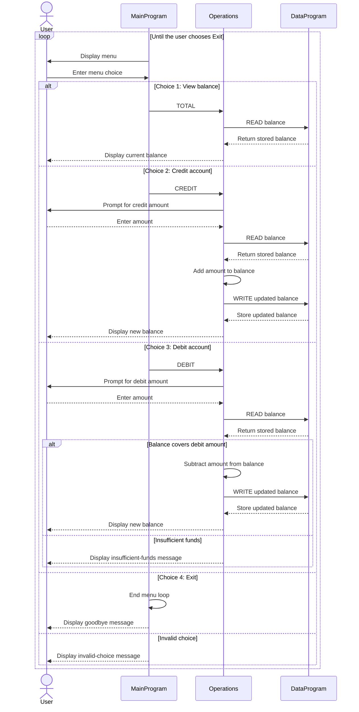

# COBOL Student Account Management

This directory documents the COBOL account-management example in `src/cobol`. The program provides a console menu for viewing and changing one account balance. Although this exercise describes the account as a student account, the code does not store student identity or account-specific details.

## Source files

### `src/cobol/main.cob` - `MainProgram`

The entry point and console interface. It repeatedly displays the account menu, accepts a choice, and calls `Operations` with the corresponding operation code:

- `1`: view the balance (`TOTAL`, padded with one trailing space to six characters)
- `2`: credit the account (`CREDIT`)
- `3`: debit the account (`DEBIT`, padded with one trailing space to six characters)
- `4`: exit

Any other menu choice displays an invalid-choice message. Choosing exit ends the loop and stops the program.

### `src/cobol/operations.cob` - `Operations`

Implements the account actions and prompts for transaction amounts.

- **View balance (`TOTAL`):** Reads the stored balance from `DataProgram` and displays it. The operation code is padded with one trailing space to six characters.
- **Credit (`CREDIT`):** Accepts an amount, reads the current balance, adds the amount, writes the result, and displays the new balance.
- **Debit (`DEBIT`):** Accepts an amount and reads the current balance. It subtracts and saves the amount only when the balance is greater than or equal to it; otherwise, it displays an insufficient-funds message. The operation code is padded with one trailing space to six characters.

`FINAL-BALANCE` is the working value passed between `Operations` and `DataProgram`; the persistent-in-process balance is held by `DataProgram`.

### `src/cobol/data.cob` - `DataProgram`

Provides the balance storage interface. `STORAGE-BALANCE` starts at `1000.00`. The program accepts an operation code and a balance:

- `READ` copies the stored balance into the caller's balance field.
- `WRITE` copies the caller's balance into storage.

The balance is maintained in the program's working storage while the program runs; no file or database persistence is implemented.

## Student account business rules

- A new program run starts with a balance of **1,000.00**.
- Credits increase the balance by the entered amount.
- Debits are allowed only if the current balance covers the entered amount. A debit cannot take the balance below zero.
- An attempted debit greater than the available balance is rejected without changing the stored balance.
- The program does not enforce a minimum balance, transaction limits, student eligibility, account ownership, or a maximum balance.
- Entered amounts are not checked for positivity. In particular, negative or otherwise invalid amounts may produce unintended results; add validation before using this as a real account system.
- The account is not associated with a student record, and balance changes are not persisted across program runs.

## Node.js port (`src/accounting`)

`src/accounting/index.js` keeps the business rules above but does **not** reproduce the COBOL legacy quirks (test plan cases marked **[Legacy quirk]**). Instead it validates input:

| Input | COBOL behavior | Node.js behavior |
|---|---|---|
| Negative amount, e.g. `-100` (TC-029, TC-030) | Sign is dropped; amount is applied as positive | Rejected with "Invalid amount. Please enter a non-negative number (max 999999.99)." |
| Non-numeric amount, e.g. `abc` (TC-031) | Treated as zero | Rejected with the invalid-amount message |
| Amount with more than six integer digits (TC-034) | High-order digits truncated | Rejected with the invalid-amount message |
| Credit that would exceed 999,999.99 (TC-033) | Balance silently overflows | Rejected with "Credit rejected: balance cannot exceed 999999.99." |
| Credit reaching exactly 999,999.99 (TC-032) | Input truncated to `999999.90` | Balance becomes `999999.99` |
| Multi-character menu input, e.g. `12` (TC-035) | Only the first digit is used | Treated as an invalid choice |

Rejected input never changes the stored balance. Extra decimal places are still truncated, not rounded (TC-008).

Run the unit tests from `src/accounting`:

```bash
npm install
npm test
```

## Application data flow


